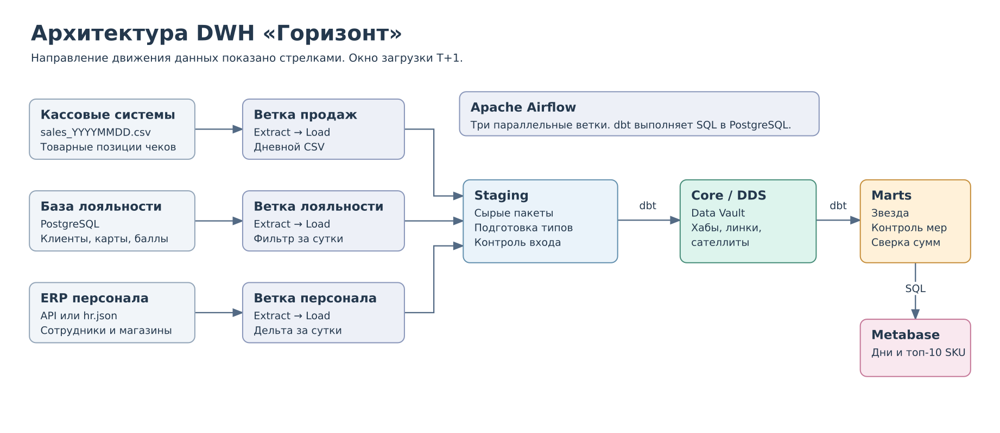

# «Горизонт» — DWH для розничной сети

Итоговая работа по модулю «Проектирование DWH и ELT-процессов». Ежедневный DAG загружает кассовый CSV, данные PostgreSQL программы лояльности и данные ERP персонала. dbt выполняет преобразования в PostgreSQL, проверяет данные и публикует витрину. Metabase читает витрину продаж.



| Материал | Содержание |
|---|---|
| [Проектное решение](docs/solution.md) | Источники, модели DDS, звезда, ELT, формулы, правила качества и допущения |
| [Редактируемые схемы](docs/horizon.drawio) | Четыре страницы для diagrams.net (draw.io) |
| [Проверка результата](docs/verification.md) | Два прогона за одну дату, инкремент, отрицательные сценарии и сверка |
| [Lineage dbt](docs/dbt-lineage.png) | Граф зависимостей, сформированный в dbt Docs |
| [Дашборд Metabase](bi/dashboard.png) | Продажи по дням и топ-10 товаров по выручке |
| [Код DAG](dags/horizon_elt.py), [модели dbt](dbt/models), [SQL](sql), [BI](bi) | Исходники и загрузка демонстрационных данных |

## Локальный запуск

Проверено с Python 3.12, PostgreSQL 16, Airflow 2.10.5, dbt Core 1.9.10 (адаптер postgres 1.9.1) и Metabase 0.54.10. Команды ниже предполагают Bash и запущенный PostgreSQL. Для метаданных локального Airflow используется его стандартная SQLite. Создайте учебные базы и роли в своём экземпляре PostgreSQL.

```bash
createuser -P horizon_elt
createuser -P horizon_bi
createdb --owner=horizon_elt horizon
createdb loyalty_db

python3.12 -m venv .venv
source .venv/bin/activate
python -m pip install -r requirements.txt
cp .env.example .env
```

Заполните `.env` локальными параметрами подключения. Для демо задайте в `LOYALTY_DSN` роль владельца учебной базы `loyalty_db`, чтобы генератор мог создавать таблицы и строки. Для рабочего источника задаётся роль только на чтение. `DWH_DSN` и переменные профиля dbt должны указывать на одну целевую БД.

```bash
source .env
python tools/demo_data.py
airflow db migrate
dbt deps --project-dir dbt --profiles-dir dbt

python tools/run_batch.py 2026-11-09
python tools/verify_batch.py 2026-11-09 > first.json
python tools/run_batch.py 2026-11-09
python tools/verify_batch.py 2026-11-09 > repeated.json
diff -u first.json repeated.json
python tools/run_batch.py 2026-11-{10..17}
python tools/verify_batch.py 2026-11-16
python tools/verify_batch.py 2026-11-17 --allow-missing
```

`run_batch.py` исполняет задачи DAG через `dag.test()` для заданной бизнес-даты. При работе по расписанию задайте переменные в среде scheduler и workers, разместите исходные файлы в `HORIZON_DATA_DIR` и запустите Airflow. В одном локальном экземпляре достаточно `airflow standalone`. После запуска включите DAG `horizon_elt`. Все исполнители, обслуживающие один DAG, должны видеть каталог `HORIZON_WORK_DIR`, код и окружение dbt. По умолчанию используются каталоги `demo-data` и `work` рядом с кодом. Старт истории задаётся через `start_date`, для первой загрузки используйте хронологический порядок.

В рабочем режиме кассовая ветка читает именованный CSV. HR-ветка принимает суточный `hr/YYYY-MM-DD.json` или общий `hr.json`. Для ERP API задайте `HR_API_URL` и при необходимости `HR_API_TOKEN`. API должен возвращать массив записей за дату из параметра `date`.

## Граф зависимостей

```bash
dbt docs generate --project-dir dbt --profiles-dir dbt \
  --vars '{"batch_date":"2026-11-16"}' --static
dbt docs serve --project-dir dbt --profiles-dir dbt --port 8081
```

В dbt Docs откройте `fct_sales_daily` и граф зависимостей. `dbt docs generate --static` также создаёт переносимый файл `dbt/target/static_index.html`.

## Дашборд Metabase

1. После загрузки витрины выполните от её владельца `psql "$DWH_DSN" -v ON_ERROR_STOP=1 -f bi/grants.sql`.
2. Запустите локальный Metabase 0.54.10. В Metabase добавьте PostgreSQL с ролью `horizon_bi` и схемой `marts`.
3. Создайте два SQL-вопроса по файлам [sales_by_day.sql](bi/sales_by_day.sql) и [top_products.sql](bi/top_products.sql), выберите линию и столбцы, добавьте оба вопроса на дашборд. Для локального демо можно выполнить `python bi/create_dashboard.py`, предварительно задав `METABASE_URL`, `METABASE_EMAIL`, `METABASE_PASSWORD` и `HORIZON_BI_PASSWORD`. Скрипт создаёт новый дашборд при запуске.
