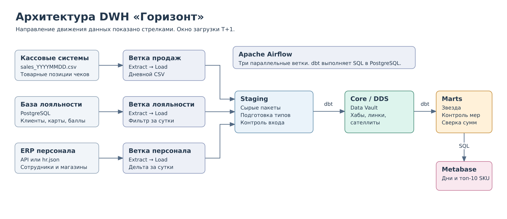
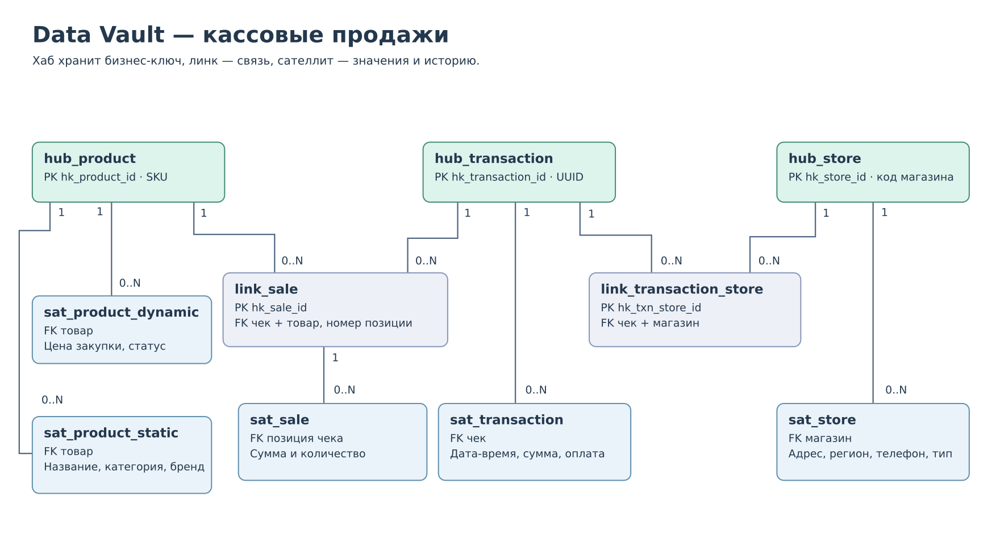
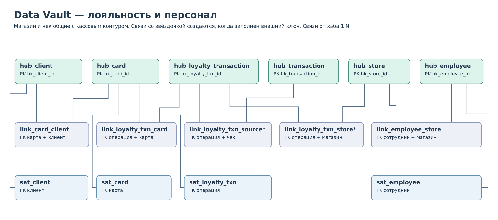
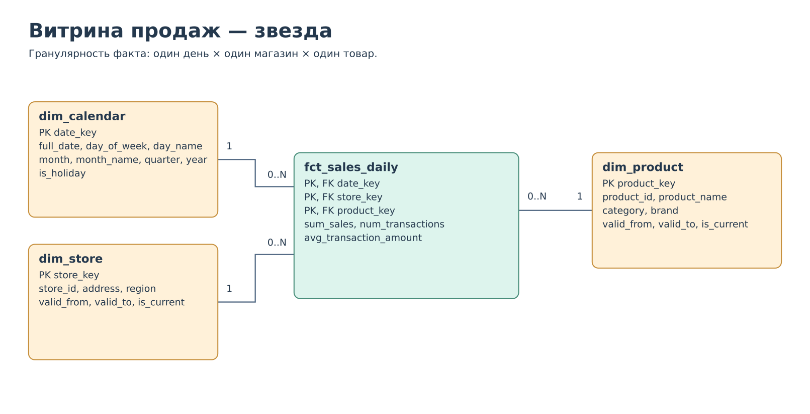

# Проектное решение

Розничной сети «Горизонт» нужна ежедневная отчётность о продажах по данным касс, программы лояльности и ERP персонала. В пилоте реализована витрина для ежедневной динамики выручки и рейтинга SKU. В DDS загружаются данные всех трёх источников.

## Требования задания и решения проекта

| Требование задания | Решение |
|---|---|
| Продажи по итогам прошедших суток, T+1 | Один запуск в сутки. Дата берётся из конца интервала DAG минус один день. Для проверки и ручной дозагрузки предусмотрен `dag_run.conf.batch_date`. |
| Инкремент из трёх источников | Кассовый CSV за конкретный день, PostgreSQL по исходным датам, суточная дельта ERP или фильтр по датам найма и увольнения. |
| Core по Data Vault | Бизнес-ключи в хабах, отношения в линках, атрибуты и их изменения в сателлитах. |
| Звезда для ежедневных продаж | Три измерения и факт с зерном день × магазин × товар. |
| Сверка и визуализация | Контрольные суммы Staging и Marts, тесты dbt и два графика Metabase. |

PostgreSQL хранит все три слоя и выполняет SQL. Для суточного учебного сценария достаточно одной СУБД. Airflow задаёт расписание, зависимости и повторные попытки. dbt хранит преобразования, тесты и граф зависимостей рядом с кодом. В Metabase подключена роль с доступом на чтение только к опубликованной витрине и её измерениям.

## Архитектура и запуск пакета

| Слой | Назначение | Таблицы и преобразования |
|---|---|---|
| Staging | Сохранить содержимое исходных строк и контрольные метаданные | `raw_records` хранит JSON записей с датой пакета и порядком. `load_batches` фиксирует источник, имя файла или тип источника, число строк и время загрузки. `stg_*` приводят типы, ключи и пустые строки к согласованному виду. |
| Core / DDS | Интеграция трёх источников и история | Хабы определяют ключи, линки хранят связи, сателлиты хранят атрибуты. |
| Marts | Данные для BI | `dim_calendar`, `dim_store`, `dim_product`, `fct_sales_daily`. Промежуточный расчёт `int_sales_daily_batch` используется для проверки текущего дня перед публикацией. |

`init_batch` создаёт сырые таблицы при первом запуске. После него идут три независимые цепочки Extract → Load. Каждая запись пакета и строка аудита загружаются в одной транзакции PostgreSQL. Перед повторной загрузкой Airflow проверяет строку аудита. Один DAG допускает одновременно один активный запуск.

Затем dbt строит модели Staging и Core, измерения и суточный расчёт. Если проверки прошли, следующий шаг dbt дописывает новые ключи в `fct_sales_daily`. Финальный шаг Airflow сверяет суммы сырого слоя и витрины. В логе видны дата, количество строк по источникам, результат тестов и контрольные суммы. При отсутствующем CSV DAG пишет предупреждение, обрабатывает лояльность и ERP и продолжает без публикации продаж за этот день. Если файл появится позже, можно повторить запуск за эту дату.

| Источник | Инкремент | Правило ключа |
|---|---|---|
| Кассы, `sales_YYYYMMDD.csv` | Один файл общего формата за день. `datetime` трактуется как локальное время магазина, дата строки должна совпадать с датой файла. | Глобальный UUID чека и порядковый номер строки в файле идентифицируют позицию. SKU может повторяться в одном чеке. |
| PostgreSQL, `clients`, `cards`, `transactions` | Даты регистрации и выдачи равны дате пакета. Операции фильтруются по интервалу от начала дня включительно до начала следующего дня. Три выборки выполняются в одной read-only транзакции. | Используются исходные целочисленные ключи. Магазин и связь с чеком у операции лояльности могут отсутствовать. |
| ERP, API или JSON | Из API и датированного JSON берётся суточная дельта. Из общего `hr.json` выбираются записи с датой найма либо увольнения, равной дате пакета. | `employee_id` идентифицирует сотрудника, `store_id` — место работы, известное на день версии. |

Для продаж файл считается полным и неизменяемым после загрузки. Повтор того же дня использует загруженный пакет и сохраняет факты. Исправления опубликованных пакетов, возвраты и загрузка CSV, который сам содержит ошибочные дубли, требуют отдельного согласования с владельцем касс. Без идентификатора позиции две одинаковые строки могут быть реальными позициями, поэтому содержимое позиции в качестве ключа не используется.

## DDS по Data Vault

Хэш-ключи создаются как MD5 от JSON-массива составляющих бизнес-ключей. Это сохраняет границы значений составного ключа. У каждого объекта есть бизнес-дата пакета, время загрузки и источник. В хабах ключ добавляется один раз. В линках ключ содержит участвующие хабы, а для позиции продажи включает также `line_no`. Сателлит пишет версию при изменении `hashdiff`. Ключ версии состоит из ключа родителя и даты пакета.

| Хаб | Бизнес-ключ | Хэш-ключ |
|---|---|---|
| `hub_transaction` | `transaction_id` | `hk_transaction_id` |
| `hub_product` | `product_id` | `hk_product_id` |
| `hub_store` | `store_id` | `hk_store_id` |
| `hub_client` | `client_id` | `hk_client_id` |
| `hub_card` | `card_id` | `hk_card_id` |
| `hub_loyalty_transaction` | `loyalty_transaction_id` | `hk_loyalty_txn_id` |
| `hub_employee` | `employee_id` | `hk_employee_id` |

| Линк | Участвующие хабы | Хэш-ключ |
|---|---|---|
| `link_sale` | Чек, товар. В ключе ещё номер позиции | `hk_sale_id` |
| `link_transaction_store` | Чек, магазин кассовой продажи | `hk_txn_store_id` |
| `link_card_client` | Карта, клиент | `hk_card_client_id` |
| `link_loyalty_txn_store` | Операция с баллами, магазин при наличии | `hk_loyalty_store_id` |
| `link_loyalty_txn_source` | Операция с баллами, чек при наличии | `hk_loyalty_source_id` |
| `link_loyalty_txn_card` | Операция с баллами, карта. Сохраняет связь `transactions.card_id` из задания | `hk_loyalty_card_id` |
| `link_employee_store` | Сотрудник, магазин | `hk_employee_store_id` |

| Сателлит | Атрибуты |
|---|---|
| `sat_product_static` | Наименование, категория, бренд |
| `sat_product_dynamic` | Цена закупки, статус товара |
| `sat_store` | Адрес, регион, телефон, тип |
| `sat_transaction` | Время чека, полная сумма по позициям, способ оплаты при наличии |
| `sat_client` | ФИО, дата рождения, телефон, email, дата регистрации |
| `sat_card` | Номер, дата выдачи, статус |
| `sat_loyalty_txn` | Баллы со знаком, дата операции, начисление или списание |
| `sat_employee` | ФИО, должность, даты найма и увольнения |
| `sat_sale` | Стоимость позиции после скидки, количество |

В тексте задания три модели названы `hub_customer`, `link_transaction` и `sat_transaction_details`. Эти имена используются для файлов dbt. В PostgreSQL соответствующие таблицы названы `hub_client`, `link_transaction_store` и `sat_transaction` по схеме задания.

Из необязательной ссылки лояльности извлекается ключ чека, даже если детализация кассовой продажи ещё не получена. Витрина включает кассовые позиции с полноценным заголовком чека. Связи с картой и клиентом требуют, чтобы ключи были загружены ранее либо в том же пакете. При их отсутствии тест dbt блокирует публикацию, а владелец источника проверяет полноту истории регистраций и выдач.

## Модель витрины и показатели

| Объект | Зерно и ключ | Поля |
|---|---|---|
| `dim_calendar` | Один календарный день. PK `date_key` в формате YYYYMMDD, int | `full_date` (date), день недели 1–7, его название, месяц 1–12 и название месяца, квартал, год и `is_holiday` (boolean). Числовые поля календаря — smallint. Название дня сокращено до Пн–Вс и хранится в varchar(10). |
| `dim_product` | Один SKU. PK `product_key`, int | `product_id`, `product_name`, `category`, `brand`, `valid_from`, `valid_to`, `is_current`. |
| `dim_store` | Один магазин. PK `store_key`, int | `store_id`, `address`, `region`, `valid_from`, `valid_to`, `is_current`. |
| `fct_sales_daily` | День × магазин × товар. Составной PK из трёх FK, int | `sum_sales` numeric(12,2), `num_transactions` int, `avg_transaction_amount` numeric(10,2). |

Суррогатные ключи SKU и магазина выдаются новым элементам и остаются стабильными при повторе. `valid_from` соответствует первому появлению сущности. При единственной версии `valid_to = NULL`, `is_current = true`. Обозначение PK на схемах отражает ключ модели. PostgreSQL защищает ключи уникальными индексами, dbt проверяет обязательность и ссылочную целостность.

- **Выручка товара** — сумма стоимости его позиций после скидок по дню и магазину. Её можно суммировать по дням, магазинам и товарам.
- **Число чеков с товаром** — число уникальных UUID чека после группировки позиций по чеку и SKU. Если чек содержит несколько SKU, он войдёт в несколько групп. Общий счётчик чеков сети следует считать отдельно по UUID.
- **Средний чек по товару** — среднее полной суммы уникальных чеков, в которых товар присутствует. Сначала складываются все позиции каждого чека, затем полная сумма каждого подходящего чека учитывается один раз. Округление до копеек выполняется после вычисления среднего. Для более крупного разреза требуется пересчёт на уровне чеков. Среднее от средних по SKU приведёт к двойному учёту.
- **Сопоставимые продажи (LFL)** — изменение выручки между равными текущим и базовым периодами по магазинам, которые были открыты и сопоставимо работали в обоих периодах. Формула `(выручка текущего периода / выручка базового − 1) × 100%`. При нулевой базе результат не определён. Для расчёта требуется история открытия, закрытия и существенных изменений магазина. В проекте приведено определение по заданию.

## Контроль качества и хранение

| Слой | Правило | Реакция и роль |
|---|---|---|
| Staging | Файл соответствует дню, количество загруженных строк совпадает с аудитом. У чека заполнены UUID, SKU, магазин и время. Все позиции одного чека имеют один магазин и время. `sales_amount > 0`. | Нет файла — предупреждение и пропуск дня продаж. Ошибка данных — остановка публикации и уточнение у владельца источника. |
| DDS | `not_null` и `unique` на хэш-ключах хабов, `relationships` на связях и сателлитах, `accepted_values` на статусах карт в Staging. | Порог 0 нарушений. Data Engineer локализует ошибку. Повтор успешен после восстановления корректного пакета в Staging. |
| Marts | Ключ витрины уникален. Сумма по позициям, количество чеков и средний чек совпадают с независимым пересчётом из Staging. Разница общей суммы между raw и фактом равна 0. | Критичные отклонения блокируют публикацию текущего расчёта. Владелец показателя подтверждает формулу, Data Engineer отвечает за исправление. |

Регламент проекта предполагает хранение сырых строк и технических копий выгрузок 30 дней после подтверждённой публикации. Журнал аудита сроком 90 дней помогает разобрать пропуски и повторные запуски. Очистка выполняется по согласованию с владельцем данных. Политика задана документом, удаление в учебном DAG не включено.

Для закупочной цены в Core предлагается SCD Type 2 при появлении справочника. При новом значении добавляется версия по ключу товара и дате изменения. Интервал действия выводится из дат соседних версий `[valid_from, valid_to)`, последняя версия открыта. Текущие исходники цены не передают. Для доступа к Core и Staging применяются отдельные права из-за персональных данных клиентов и сотрудников. В BI используется роль только для чтения и публикуются агрегаты и безопасные атрибуты.

## Допущения и границы данных

- В итоговом задании приведены структуры, а исполняемые выгрузки и URL рабочего ERP отсутствуют. Проверка выполнена на синтетических данных, созданных генератором по структурам задания.
- Для пилота время запуска привязано к Europe/Samara. Дата кассовой операции остаётся локальной датой магазина без конвертации. Полнота суточного файла должна обеспечиваться источником к моменту загрузки.
- Исходники дают коды магазинов и SKU. Отдельных справочников товаров, магазинов и региональных праздников нет. Неизвестные атрибуты имеют `NULL`. Календарь помечает фиксированные федеральные праздники и даты из параметра dbt regional_holidays. Для остальных дат флаг равен false. В учебном примере список региональных праздников пуст.
- Справочник лояльности загружается по датам регистрации и выдачи. Для первичной загрузки рабочей базы нужна история или согласованный стартовый снимок. Обнаружение дальнейших изменений анкет и статусов требует признака изменения или дельты источника. В статическом HR-файле фиксируются даты найма и увольнения, изменения должности или магазина доступны при суточной дельте.
- Суммы считаются в рублях. Строки с нулевой либо отрицательной суммой выходят за правило качества задания. В рабочем контуре показатель возвратов потребовал бы отдельного контракта.
- Файлы по условиям перевода в работу должны содержать полный суточный пакет. Оригинальные названия `oquantity` и `ohire_date` трактуются как варианты `quantity` и `hire_date` и принимаются загрузчиком.
- Продажи по сотрудникам, остатки и ABC по категориям требуют дополнительных полей источника или справочников. В пилоте доступны продажи по SKU, дням и магазинам. Все три источника представлены в Core.

## Материалы курса

- [Слои данных и их назначение](https://netology.ru/profile/program/pwh-29/lessons/660633/lesson_items/3541597) и [выбор инструментов](https://netology.ru/profile/program/pwh-29/lessons/660635/lesson_items/3541625) — роли слоёв и выбор одной СУБД для пакетной обработки.
- [Подходы к моделированию](https://netology.ru/profile/program/pwh-29/lessons/660634/lesson_items/3541604) и [практика витринной схемы](https://netology.ru/profile/program/pwh-29/lessons/660634/lesson_items/3541611) — разделение Data Vault и звезды, выбор зерна и историзация.
- [Современный ELT-процесс](https://netology.ru/profile/program/pwh-29/lessons/660636/lesson_items/3541631) и [паттерны обновления](https://netology.ru/profile/program/pwh-29/lessons/660636/lesson_items/3541632) — суточный инкремент, зависимости и сохранение истории.
- [Data Governance и Data Quality](https://netology.ru/profile/program/pwh-29/lessons/660637/lesson_items/3541643) и [тестирование витрин и слоёв](https://netology.ru/profile/program/pwh-29/lessons/660638/lesson_items/3541648) — точки контроля, сверка выручки и проверка повторного запуска.
- [Итоговое задание «Горизонт»](https://netology.ru/profile/program/pwh-29/lessons/660639/lesson_items/3541650) — структура источников и критерии приёмки.
